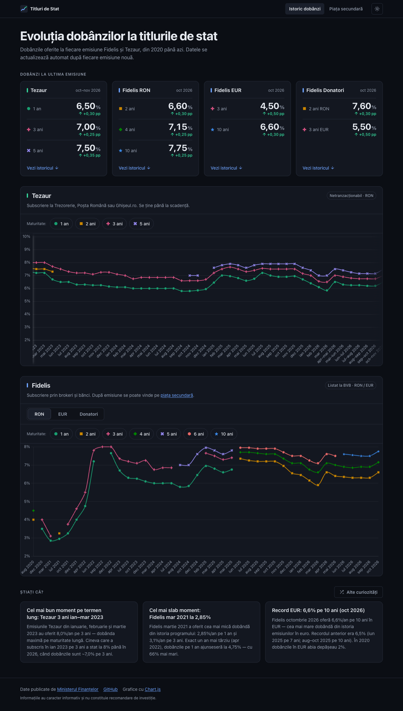

# Titluri de Stat România — Fidelis & Tezaur

Interactive charts tracking the evolution of Romanian government bond yields (Fidelis and Tezaur) from 2020 to present.

**Live site:** https://victorsc.github.io/titluri-de-stat/



---

## What it shows

| Instrument | Type | Currency | Maturities |
|------------|------|----------|------------|
| **Tezaur** | Direct subscription via Ghișeul.ro / Poștă | RON | 1, 2, 3, 5 years |
| **Fidelis** | Listed on the Bucharest Stock Exchange (BVB) | RON | 1–6 and 10 years |
| **Fidelis** | Listed on the Bucharest Stock Exchange (BVB) | EUR | 1, 2, 3, 5, 7, 10 years |
| **Fidelis Donatori** | Blood-donor issues | RON + EUR | 1, 2, 3, 10 years |

A second page, [`market.html`](https://victorsc.github.io/titluri-de-stat/market.html), is a secondary-market screener for listed Fidelis bonds (bid/ask prices, YTM, buy labels) with a local portfolio tracker.

Data sources: [fidelis.ro](https://www.fidelis.ro) (Ministerul Finanțelor) for issue rates; [fidelis.pacalab.ro](https://fidelis.pacalab.ro) for daily BVB quotes.

---

## Project structure

```
├── public/                           # Everything deployed to GitHub Pages
│   ├── index.html                    # Rate history charts (Chart.js, no framework)
│   ├── market.html                   # Secondary-market screener + portfolio
│   ├── app.js, market.js, style.css
│   ├── vendor/chart.umd.min.js       # Chart.js 4, vendored
│   └── data/
│       ├── fidelis.json              # Fidelis RON, EUR and donor rates
│       ├── tezaur.json               # Tezaur rates
│       ├── fun-facts.json            # "Știați că?" cards
│       └── fidelis_yields.json       # Daily BVB quotes snapshot
├── scripts/
│   ├── scrape.js                     # fidelis.ro scraper (cheerio)
│   ├── fetch-market.js               # BVB quotes fetcher
│   └── package.json
└── .github/workflows/
    ├── deploy.yml                    # Deploys public/ on every push to main
    ├── update-data.yml               # Scrapes rates every odd day, 08:00 UTC
    └── update-market-data.yml        # Fetches BVB quotes daily, 21:00 UTC
```

---

## Updating data

### Automatic (GitHub Actions)

A scheduled workflow runs at **08:00 UTC on every odd day of the month** (1st, 3rd, …, 31st). It scrapes the current emission from fidelis.ro, appends any new entries to the JSON files, commits with a message like the one below, and triggers a redeploy:

```
chore: auto-update bond data 2026-05-01 [skip ci]
```

You can also trigger it manually from the **Actions** tab → "Update bond data" → **Run workflow**.

A second workflow ("Update market data") refreshes `fidelis_yields.json` from fidelis.pacalab.ro daily at 21:00 UTC, after the BVB close.

### Manual (local)

```bash
cd scripts
npm install
node ../scripts/scrape.js
```

The scraper is idempotent — it skips entries that already exist in the JSON files (matched by date label + maturity).

### Adding data by hand

Each entry in the JSON files follows this shape:

```json
{ "d": "May 2026", "m": 3, "r": 7.25 }
```

| Field | Description |
|-------|-------------|
| `d` | Date label — emission month, e.g. `"May 2026"` or `"Apr–May 2026"` for two-month Tezaur periods |
| `m` | Maturity in years (integer) |
| `r` | Annual interest rate as a float, e.g. `7.25` for 7.25% |

`fidelis.json` has `ron`, `eur` and `donatori: { ron, eur }` arrays; `tezaur.json` is a flat array.

Append new entries at the end of the relevant array and push. Every push to `main` redeploys the site.

---

## Tech stack

- **Chart.js 4** — line charts with horizontal scroll, touch tooltips, click-to-toggle legend
- **Vanilla JS + HTML** — no build step, no framework
- **GitHub Pages** — `public/` deployed via GitHub Actions (`deploy.yml`)
- **GitHub Actions** — scheduled scraping via Node.js + cheerio
